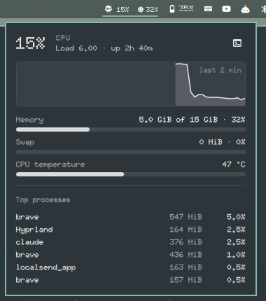

# System Monitor



An Omarchy shell bar widget showing live CPU and RAM usage (optionally CPU temperature).
Click it for a panel with:

- a CPU usage history graph (last 60 samples)
- memory, swap and CPU temperature meters
- load average and uptime
- the six busiest processes (sampled only while the panel is open)
- a button that opens or focuses `btop`

Sampling is a bash loop that reads `/proc` and sysfs with builtins only, so it stays light on low-power CPUs.

## Install

```bash
git clone https://github.com/hell0world69/omarchy-system-monitor.git ~/.config/omarchy/plugins/hell0world.system-monitor
```

Then add `{ "id": "hell0world.system-monitor" }` to a section of `bar.layout` in `~/.config/omarchy/shell.json`.

## Settings

| Key | Default | Meaning |
|-----|---------|---------|
| `interval` | `2` | Seconds between samples (1–10) |
| `showRam` | `true` | Show RAM % in the bar |
| `showTemp` | `false` | Show CPU temperature in the bar |
| `cpuWarn` | `90` | CPU % that highlights the widget |
| `tempWarn` | `85` | °C that highlights the widget |

MIT licensed.
